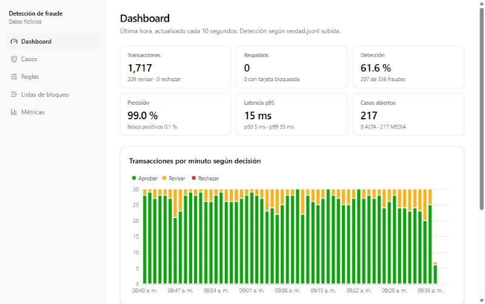
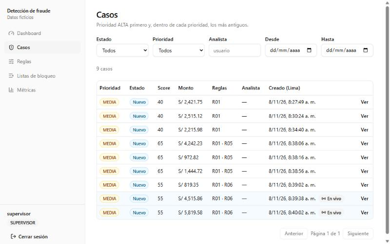
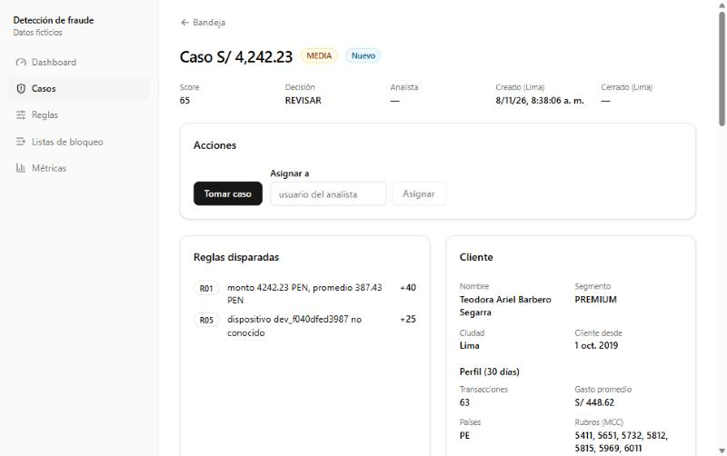
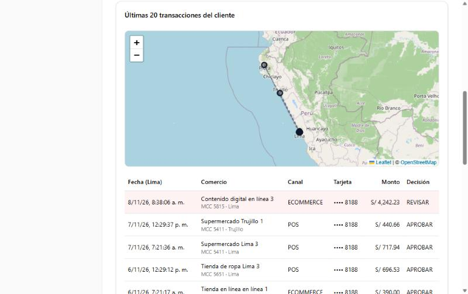
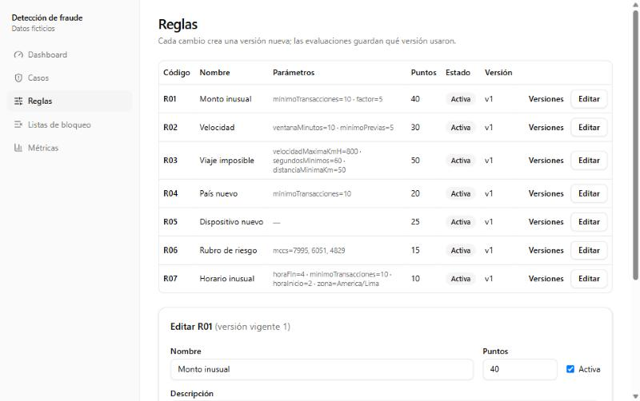
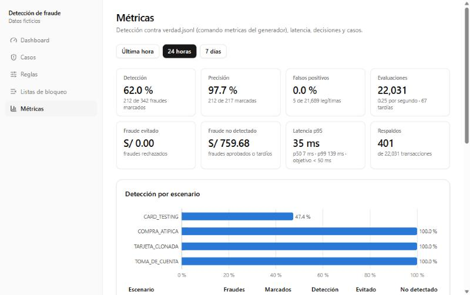
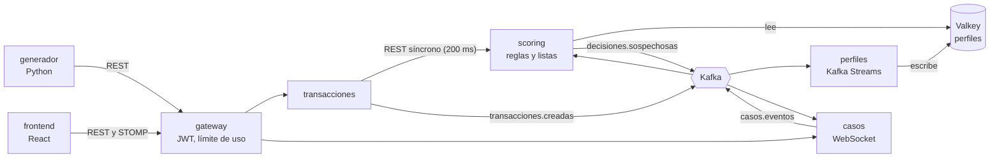

# Detección de fraude bancario en tiempo real

[](https://github.com/C4R127/deteccion_de_fraude/actions/workflows/ci.yml)

Cada vez que alguien paga con su tarjeta, el banco tiene unos milisegundos para decidir si
el pago es legítimo. Este proyecto simula ese momento de punta a punta: recibe pagos,
decide en línea si **aprobarlos, revisarlos o rechazarlos**, y envía los sospechosos a un
equipo de analistas que los investiga desde una aplicación web que se actualiza en vivo.

Es un proyecto de portafolio. **Los clientes, las tarjetas, los comercios y los pagos son
ficticios:** los crea un generador que además mete fraudes a propósito para comprobar
cuántos detecta el sistema.



<!-- GIF de demo: graba la bandeja recibiendo casos en vivo y el dashboard, y guárdalo en docs/demo.gif -->
<!--  -->

## En pocas palabras

- **Decide en milisegundos.** Un motor de reglas compara cada pago con el comportamiento
  habitual del cliente: cuánto gasta, desde qué dispositivos, en qué ciudades y a qué
  hora. El objetivo es que el 95 % de las decisiones tarde menos de 50 ms.
- **Nunca bloquea un pago por lentitud.** Si la evaluación tarda más de 200 ms, el pago
  se aprueba por respaldo y la evaluación se guarda igual para revisarla después.
- **Los analistas trabajan en vivo.** Los casos sospechosos aparecen en la bandeja sin
  recargar la página. Al confirmar un fraude, la tarjeta y el dispositivo quedan
  bloqueados.
- **Las reglas se ajustan sin programar.** Los puntos y los umbrales se editan desde la
  interfaz, y cada cambio queda versionado.
- **La detección se mide.** El generador anota qué pagos eran fraude, y el sistema
  calcula cuántos detectó y cuántas veces se equivocó.
- **Diseñado para no perder eventos.** Los servicios se comunican por Kafka con
  confirmación de entrega y reintentos, y toleran recibir el mismo mensaje dos veces.

## Recorrido por la aplicación

**Bandeja de casos.** Los pagos sospechosos se convierten en casos con prioridad. Los
nuevos llegan por WebSocket y se marcan como «En vivo». Se pueden filtrar por estado,
prioridad y analista.



**Detalle de un caso.** Muestra por qué el pago es sospechoso. En este ejemplo, el monto
es once veces el gasto promedio del cliente (R01, +40 puntos) y se hizo desde un
dispositivo que nunca había usado (R05, +25 puntos). Al lado aparece el perfil del cliente
en los últimos 30 días. El analista puede tomar el caso, asignarlo o cerrarlo.



Más abajo están las últimas 20 compras del cliente en un mapa y en una tabla. El pago
sospechoso aparece resaltado.



**Reglas.** El supervisor ajusta los puntos y parámetros de cada regla. Cada cambio crea
una versión nueva, y cada evaluación guarda con qué versión se tomó la decisión.



**Métricas.** Comparan las decisiones con la lista de fraudes reales del generador:
detección, precisión, falsos positivos y resultados por tipo de fraude.



## Cómo decide

Cada regla que se cumple suma puntos. Con **40 puntos o más** el pago queda en
**REVISAR** y abre un caso; con **70 o más**, se **RECHAZA**. Antes de las reglas se
revisan las listas de bloqueo de tarjetas, dispositivos y comercios.

| Regla | Qué detecta | Puntos |
|---|---|---|
| R01 Monto inusual | Más de 5 veces el gasto promedio del cliente | 40 |
| R02 Velocidad | 5 o más compras de la misma tarjeta en 10 minutos | 30 |
| R03 Viaje imposible | Dos compras presenciales demasiado lejos para el tiempo transcurrido (más de 800 km/h) | 50 |
| R04 País nuevo | Un país donde el cliente nunca compró | 20 |
| R05 Dispositivo nuevo | Un celular o navegador que el cliente nunca usó | 25 |
| R06 Rubro de riesgo | Apuestas, criptomonedas o transferencias de dinero | 15 |
| R07 Horario inusual | Entre las 2 y las 5 de la mañana, si el cliente nunca compra a esa hora | 10 |

Para no castigar a clientes nuevos, las reglas que dependen del historial (R01, R04 y R07)
solo se aplican cuando el cliente tiene al menos 10 compras en los últimos 30 días.

El generador simula cinco tipos de fraude:

| Escenario | Qué simula | Reglas que lo detectan |
|---|---|---|
| Tarjeta clonada | Una compra presencial a más de 400 km, minutos después de otra local | R03 |
| Card testing | Ráfaga de 6 a 12 compras pequeñas por internet para probar si la tarjeta funciona | R02 + R05 |
| Toma de cuenta | Un dispositivo nuevo con un monto mucho mayor al habitual | R05 + R01 |
| Compra atípica | Un monto muy alto en un rubro de riesgo que el cliente nunca usó | R01 + R06 |
| Uso nocturno | Compras de madrugada en rubros de riesgo desde un dispositivo nuevo | R07 + R05 + R06 |

## Resultados

Corrida en vivo de 12 minutos con 20 % de fraude en una laptop con Windows, todo local:
360 transacciones, de las cuales 60 eran fraude.

| Métrica | Valor |
|---|---|
| Detección (fraudes marcados) | 60,0 % |
| Precisión (marcados que sí eran fraude) | 97,3 % |
| Falsos positivos | 0,3 % (1 de 300 pagos legítimos) |
| Pagos aprobados por respaldo | 0 de 360 |
| Tiempo de decisión p50 / p95 / p99 | 3 / 4 / 8 ms |

| Escenario | Detección |
|---|---|
| Toma de cuenta | 100 % (10 de 10) |
| Compra atípica | 100 % (5 de 5) |
| Tarjeta clonada | 100 % (4 de 4) |
| Card testing | 41,5 % (17 de 41) |

En card testing, las primeras cinco compras de cada ráfaga se aprueban por diseño: la
regla de velocidad necesita ver cinco compras previas. Esto es un límite conocido de un
sistema basado en reglas. El uso nocturno no aparece porque la corrida fue de día.

Sobre 30 días de historia normal (20 295 pagos legítimos) hubo 5 falsos positivos
(0,02 %). Todos fueron de R01 y se deben a la variación natural de los montos.

**Prueba de carga** (k6, 20 transacciones por segundo durante 2 minutos a través del
gateway): 2401 solicitudes, 0 errores, p95 del scoring 14 ms y p95 de punta a punta
182 ms.

## Arquitectura



1. El **gateway** valida el token de Keycloak y pasa el pago a **transacciones**.
2. **transacciones** pide la decisión al **scoring** con un tiempo límite de 200 ms. Si no
   llega a tiempo, aprueba por respaldo
   ([ADR 0001](docs/adr/0001-decision-en-linea-con-respaldo.md)).
3. **scoring** revisa las listas de bloqueo y aplica las reglas con el perfil del cliente
   guardado en Valkey.
4. **perfiles** (Kafka Streams) actualiza los perfiles después, a partir de los eventos
   ([ADR 0002](docs/adr/0002-valkey-para-perfiles.md)).
5. **casos** abre un caso por cada decisión sospechosa y lo envía en vivo a la bandeja.

Decisiones de diseño destacadas:

- **La decisión es síncrona y el resto es asíncrono.** El pago espera solo al scoring;
  los perfiles y los casos se actualizan por eventos.
- **Una base de datos por servicio.** Cada servicio tiene su propio esquema en PostgreSQL
  y ninguno lee el de otro ([ADR 0004](docs/adr/0004-esquema-por-servicio.md)).
- **Entrega confiable de eventos.** Hay un outbox transaccional, consumidores que toleran
  mensajes duplicados y tópicos de mensajes fallidos (DLT)
  ([ADR 0010](docs/adr/0010-outbox-y-mensajes-venenosos.md)).
- **Auditoría.** Las evaluaciones y el historial de cada caso solo admiten inserciones.
- **Roles.** Hay analistas, supervisores, administradores y auditores. El auditor ve el
  nombre del cliente enmascarado
  ([ADR 0016](docs/adr/0016-nombre-del-cliente-enmascarado.md)).

Las 17 decisiones de arquitectura están en [docs/adr/](docs/adr/). La especificación
completa está en [docs/especificacion.md](docs/especificacion.md) y el plan de
implementación en [docs/plan-implementacion.md](docs/plan-implementacion.md).

## Stack

| Capa | Tecnologías |
|---|---|
| Backend | Java 21, Spring Boot 3.5, Spring Cloud Gateway, Flyway |
| Mensajería y datos | Apache Kafka 4 (KRaft), Kafka Streams, PostgreSQL 16, Valkey 8 |
| Seguridad | Keycloak 26 (OAuth 2 / OpenID Connect) |
| Frontend | React 19, TypeScript, Vite, Tailwind, shadcn/ui, TanStack Query y Table, ECharts, Leaflet |
| Generador | Python 3.12 |
| Observabilidad | Prometheus, Grafana, Micrometer |
| Pruebas | JUnit, Testcontainers, Vitest, pytest, k6, GitHub Actions |

## Pruébalo en tu máquina

### Requisitos

- Java 21 (Temurin). No hace falta instalar Maven: el repositorio trae `./mvnw` (o
  `mvnw.cmd` en Windows).
- Docker, para la infraestructura y para Testcontainers.
- Python 3.12, para el generador.
- Node.js 24, para el frontend.

Los comandos se ejecutan desde la raíz del repositorio. En Windows con PowerShell o
cmd, cambia `python3.12` por `py -3.12` y `.venv/bin/python` por `.venv\Scripts\python`.

### 1. Secretos e infraestructura

```bash
cp .env.example .env
docker compose -f infra/docker-compose.yml up -d
```

Esto levanta lo siguiente; los tópicos de Kafka se crean solos:

| Servicio | Dirección |
|---|---|
| Kafka | `localhost:9092` |
| Kafka UI | http://localhost:8090 |
| PostgreSQL | `localhost:5432` |
| Valkey | `localhost:6379` |
| Keycloak | http://localhost:8180 (realm `fraude`) |
| Prometheus | http://localhost:9090 |
| Grafana | http://localhost:3000 |

Los valores de `.env.example` son solo para uso local. Los puertos se publican solo en
`127.0.0.1`.

Antes de seguir, espera a que `docker compose -f infra/docker-compose.yml ps` muestre todo
como `healthy`. Keycloak tarda alrededor de un minuto en importar el realm; si el
generador pide un token antes, falla con "Server disconnected".

### 2. Servicios

```bash
./mvnw -DskipTests package
java -jar services/perfiles/target/perfiles-0.1.0-SNAPSHOT.jar
java -jar services/scoring/target/scoring-0.1.0-SNAPSHOT.jar
java -jar services/transacciones/target/transacciones-0.1.0-SNAPSHOT.jar
java -jar services/casos/target/casos-0.1.0-SNAPSHOT.jar
java -jar services/gateway/target/gateway-0.1.0-SNAPSHOT.jar
```

Cada `java -jar` va en su propia terminal, desde la raíz (ahí leen el `.env`). También
se puede usar `./mvnw -pl services/<servicio> spring-boot:run`.

| Servicio | Puerto | Swagger |
|---|---|---|
| gateway | 8080 | — |
| transacciones | 8081 | http://localhost:8081/swagger-ui/index.html |
| scoring | 8082 | http://localhost:8082/swagger-ui/index.html |
| perfiles (actuator) | 8083 | — |
| casos | 8084 | http://localhost:8084/swagger-ui/index.html |

### 3. Datos: clientes y 30 días de historia

```bash
cd generador
python3.12 -m venv .venv
.venv/bin/python -m pip install -e ".[dev]"
.venv/bin/python -m generador siembra
.venv/bin/python -m generador historia --dias 30
```

`siembra` crea 500 clientes con sus tarjetas, comercios y dispositivos. `historia` envía
unos 21 000 pagos normales con fechas pasadas para llenar los perfiles; tarda entre 10 y 20
minutos.

### 4. Frontend

```bash
cd frontend
npm install
npm run dev
```

Abre http://localhost:5173 e inicia sesión con un usuario de prueba. Vite reenvía `/api`
y `/ws` al gateway.

| Usuario | Rol | Puede |
|---|---|---|
| `admin` | ADMIN | todo, incluido subir la verdad |
| `supervisor` | SUPERVISOR | reglas, listas de bloqueo, asignar y cerrar casos |
| `analista1`, `analista2` | ANALISTA | tomar, investigar y cerrar sus casos; notas |
| `auditor` | AUDITOR | solo lectura; ve el nombre del cliente enmascarado |

Las contraseñas están en `.env` (por defecto, las de `.env.example`). El cliente OAuth
`generador` (rol SISTEMA) es el único que crea transacciones.

### 5. Tráfico en vivo con fraude y métricas de detección

```bash
cd generador
.venv/bin/python -m generador vivo --duracion 600
.venv/bin/python -m generador metricas
```

- `vivo` envía 0,5 transacciones por segundo con un 2 % de fraude (`config.yaml`). Cada
  fraude queda en `generador/verdad.jsonl` y su caso aparece en la bandeja.
- Con el 2 %, diez minutos dejan apenas unos pocos fraudes. Para una demo corta, copia
  `config.yaml` con `proporcion_fraude: 0.2` y pásalo con `--config` (antes del comando:
  `python -m generador --config demo.yaml vivo --duracion 600`).
- `metricas` sube `verdad.jsonl` al scoring; la página **Métricas** muestra detección,
  precisión y falsos positivos.
- Cada tarjeta espera 15 minutos entre compras normales y `USO_NOCTURNO` solo ocurre de
  madrugada en Lima ([ADR 0015](docs/adr/0015-escenarios-de-fraude-y-ritmo-vivo.md)).

Para empezar de cero: `docker compose -f infra/docker-compose.yml down -v`, que borra los
datos, y después repite los pasos 1 a 3.

### Observabilidad

Prometheus y Grafana se levantan junto con el resto de la infraestructura (paso 1):

- **Grafana** (http://localhost:3000): usuario `admin`, contraseña `GF_SECURITY_ADMIN_PASSWORD`
  del `.env`. El tablero *Detección de fraude: operación* muestra:
  - transacciones por segundo según la decisión;
  - respaldos;
  - latencia p50/p95/p99 del scoring;
  - servicios arriba;
  - lag de los consumidores de Kafka;
  - eventos pendientes en el outbox.
- **Prometheus** (http://localhost:9090): lee `/actuator/prometheus` de los cinco servicios
  cada 5 s. Las alertas (servicio caído, outbox creciendo, lag alto, p95 sobre 50 ms y
  respaldos sobre el 5 %) se ven en http://localhost:9090/alerts; en local no hay
  Alertmanager.

### Prueba de carga

```bash
mkdir -p pruebas-carga/datos
generador/.venv/bin/python -m generador seco --dias 1 > pruebas-carga/datos/transacciones.jsonl
docker run --rm -v "$PWD/pruebas-carga:/scripts" -e TOKEN=<token del cliente generador> \
  -e GATEWAY=http://host.docker.internal:8080 -e DATOS=/scripts/datos/transacciones.jsonl \
  grafana/k6:1.0.0 run /scripts/scoring.js
```

El encabezado de [pruebas-carga/scoring.js](pruebas-carga/scoring.js) explica cómo
obtener el token.

## Pruebas

```bash
./mvnw clean verify                      # backend: unitarias e integración con Testcontainers
cd generador && .venv/bin/python -m pytest
cd frontend && npm test && npm run build
```

El workflow [.github/workflows/ci.yml](.github/workflows/ci.yml) corre los tres en cada
push.

## Estructura

```
services/common/         eventos, errores Problem Details, seguridad y outbox compartidos
services/transacciones/  API de entrada, idempotencia, decisión con respaldo
services/scoring/        reglas, listas de bloqueo, evaluaciones, métricas de detección
services/perfiles/       Kafka Streams → Valkey
services/casos/          ciclo de vida de casos, WebSocket/STOMP
services/gateway/        Spring Cloud Gateway, validación JWT, límites de uso
generador/               clientes ficticios, escenarios de fraude, verdad.jsonl
frontend/                bandeja, detalle, reglas, listas, dashboard y métricas
infra/                   docker-compose, realm de Keycloak, script de tópicos
pruebas-carga/           k6
docs/                    especificación, plan y ADR
```

## Aviso

Este proyecto es una demostración técnica, no un sistema listo para producción. Los
secretos de `.env.example` son públicos y solo sirven para el entorno local, y los datos
son inventados. Las reglas y sus puntos son un punto de partida razonable, no un modelo
calibrado con datos reales.
