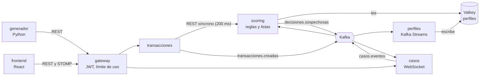

# Detección de fraude bancario en tiempo real

Plataforma de portafolio que evalúa transacciones bancarias simuladas en línea, decide
**APROBAR / REVISAR / RECHAZAR** con un motor de reglas y lleva los casos sospechosos a
una bandeja de analistas que se actualiza en vivo. Un generador inyecta fraudes conocidos
para medir la detección contra la verdad. **Todos los datos son ficticios.**

<!-- GIF de demo: graba la bandeja recibiendo casos en vivo y el dashboard, y guárdalo en docs/demo.gif -->
<!--  -->

- Especificación: [docs/especificacion.md](docs/especificacion.md)
- Plan de implementación: [docs/plan-implementacion.md](docs/plan-implementacion.md)
- Decisiones de arquitectura: [docs/adr/](docs/adr/)

## Cómo funciona



1. El gateway valida el token de Keycloak y pasa la transacción a **transacciones**.
2. transacciones pide la decisión al **scoring** con un tiempo límite de 200 ms. Si no
   llega a tiempo, aprueba por respaldo para no bloquear el pago
   ([ADR 0001](docs/adr/0001-decision-en-linea-con-respaldo.md)).
3. scoring revisa las listas de bloqueo y suma los puntos de las reglas R01–R07 con el
   perfil del cliente en Valkey. Con 40 puntos o más la decisión es REVISAR; con 70 o
   más, RECHAZAR.
4. **perfiles** (Kafka Streams) actualiza los perfiles después, por eventos
   ([ADR 0002](docs/adr/0002-valkey-para-perfiles.md)).
5. **casos** abre un caso por cada decisión sospechosa y lo envía en vivo a la bandeja.
   Cerrar un caso como fraude confirmado bloquea la tarjeta y el dispositivo.

Cada servicio tiene su propio esquema en PostgreSQL
([ADR 0004](docs/adr/0004-esquema-por-servicio.md)).

Los eventos usan outbox transaccional, consumidores idempotentes y tópicos de mensajes
fallidos (DLT) ([ADR 0010](docs/adr/0010-outbox-y-mensajes-venenosos.md)).

## Stack

Java 21, Spring Boot 3.5, Spring Cloud Gateway, Apache Kafka 4 (KRaft) y Kafka Streams,
PostgreSQL 16, Valkey 8, Keycloak 26, Python 3.12, React 19 con TypeScript, Vite,
Tailwind, shadcn/ui, TanStack Query/Table, ECharts y Leaflet. Las pruebas usan
Testcontainers, Vitest, pytest y k6.

## Requisitos

- Java 21 (Temurin). Maven no hace falta: usa `./mvnw` (o `mvnw.cmd` en Windows).
- Docker (infraestructura y Testcontainers).
- Python 3.12 (generador).
- Node.js 24 (frontend).

## Arranque paso a paso

Los comandos se ejecutan desde la raíz del repositorio. En Windows con PowerShell o
cmd, cambia `python3.12` por `py -3.12` y `.venv/bin/python` por `.venv\Scripts\python`.

**1. Secretos e infraestructura**

```bash
cp .env.example .env
docker compose -f infra/docker-compose.yml up -d
```

Esto levanta lo siguiente; los tópicos de Kafka se crean solos:

| Servicio | Dirección |
|---|---|
| Kafka | `localhost:9092` |
| Kafka UI | http://localhost:8090 |
| PostgreSQL | `localhost:5432` |
| Valkey | `localhost:6379` |
| Keycloak | http://localhost:8180 (realm `fraude`) |

Los valores de `.env.example` son solo para uso local.

Antes de seguir, espera a que `docker compose -f infra/docker-compose.yml ps` muestre todo
como `healthy`. Keycloak tarda alrededor de un minuto en importar el realm; si el
generador pide un token antes, falla con "Server disconnected".

**2. Servicios**

```bash
./mvnw -DskipTests package
java -jar services/perfiles/target/perfiles-0.1.0-SNAPSHOT.jar
java -jar services/scoring/target/scoring-0.1.0-SNAPSHOT.jar
java -jar services/transacciones/target/transacciones-0.1.0-SNAPSHOT.jar
java -jar services/casos/target/casos-0.1.0-SNAPSHOT.jar
java -jar services/gateway/target/gateway-0.1.0-SNAPSHOT.jar
```

Cada `java -jar` va en su propia terminal, desde la raíz (ahí leen el `.env`). También
se puede usar `./mvnw -pl services/<servicio> spring-boot:run`.

| Servicio | Puerto | Swagger |
|---|---|---|
| gateway | 8080 | — |
| transacciones | 8081 | http://localhost:8081/swagger-ui/index.html |
| scoring | 8082 | http://localhost:8082/swagger-ui/index.html |
| perfiles (actuator) | 8083 | — |
| casos | 8084 | http://localhost:8084/swagger-ui/index.html |

**3. Datos: clientes y 30 días de historia**

```bash
cd generador
python3.12 -m venv .venv
.venv/bin/python -m pip install -e ".[dev]"
.venv/bin/python -m generador siembra
.venv/bin/python -m generador historia --dias 30
```

`siembra` crea 500 clientes con sus tarjetas, comercios y dispositivos. `historia` envía
unos 21 000 pagos normales con fechas pasadas para llenar los perfiles; tarda entre 10 y 20
minutos.

**4. Frontend**

```bash
cd frontend
npm install
npm run dev
```

Abre http://localhost:5173 e inicia sesión con un usuario de prueba. Vite reenvía `/api`
y `/ws` al gateway.

**5. Tráfico en vivo con fraude y métricas de detección**

```bash
cd generador
.venv/bin/python -m generador vivo --duracion 600
.venv/bin/python -m generador metricas
```

- `vivo` envía 0,5 transacciones por segundo con un 2 % de fraude (`config.yaml`). Cada
  fraude queda en `generador/verdad.jsonl` y su caso aparece en la bandeja.
- Con el 2 %, diez minutos dejan apenas unos pocos fraudes. Para una demo corta, copia
  `config.yaml` con `proporcion_fraude: 0.2` y pásalo con `--config` (antes del comando:
  `python -m generador --config demo.yaml vivo --duracion 600`).
- `metricas` sube `verdad.jsonl` al scoring; la página **Métricas** muestra detección,
  precisión y falsos positivos.
- Cada tarjeta espera 15 minutos entre compras normales y `USO_NOCTURNO` solo ocurre de
  madrugada en Lima ([ADR 0015](docs/adr/0015-escenarios-de-fraude-y-ritmo-vivo.md)).

Para empezar de cero: `docker compose -f infra/docker-compose.yml down -v`, que borra los
datos, y después repite los pasos 1 a 3.

## Usuarios de prueba

Las contraseñas están en `.env` (por defecto, las de `.env.example`).

| Usuario | Rol | Puede |
|---|---|---|
| `admin` | ADMIN | todo, incluido subir la verdad |
| `supervisor` | SUPERVISOR | reglas, listas de bloqueo, asignar y cerrar casos |
| `analista1`, `analista2` | ANALISTA | tomar, investigar y cerrar sus casos; notas |
| `auditor` | AUDITOR | solo lectura; ve el nombre del cliente enmascarado |

El cliente OAuth `generador` (rol SISTEMA) es el único que crea transacciones.

## Escenarios de fraude

| Escenario | Simulación | Reglas |
|---|---|---|
| `TARJETA_CLONADA` | Compra POS a 400 km o más, minutos después de una compra local | R03 |
| `CARD_TESTING` | 6 a 12 compras de 1 a 10 PEN en menos de 10 minutos, con huella nueva | R02 + R05 |
| `TOMA_DE_CUENTA` | Dispositivo nuevo y monto mayor a 5 veces el promedio | R05 + R01 |
| `COMPRA_ATIPICA` | Monto muy alto en un rubro de riesgo nunca usado | R01 + R06 |
| `USO_NOCTURNO` | Compras en rubros de riesgo de madrugada desde un dispositivo nuevo | R07 + R05 + R06 |

## Métricas obtenidas

Corrida en vivo de 12 minutos con 20 % de fraude: 360 transacciones, 60 fraudes, de día,
en una laptop con Windows y todo local.

| Métrica | Valor |
|---|---|
| Detección (fraudes marcados) | 60,0 % |
| Precisión | 97,3 % |
| Falsos positivos | 0,3 % (1 de 300 legítimas) |
| Respaldos | 0 de 360 |
| Latencia del scoring p50 / p95 / p99 | 3 / 4 / 8 ms |

| Escenario | Detección |
|---|---|
| `TOMA_DE_CUENTA` | 100 % (10 de 10) |
| `COMPRA_ATIPICA` | 100 % (5 de 5) |
| `TARJETA_CLONADA` | 100 % (4 de 4) |
| `CARD_TESTING` | 41,5 % (17 de 41) |

Después de `historia --dias 30` (20 295 pagos normales) quedan 5 falsos positivos (0,02 %),
todos de R01 por la dispersión natural de los montos.

En `CARD_TESTING`, las primeras cinco compras de cada ráfaga se aprueban por diseño:
R02 necesita cinco compras previas. `USO_NOCTURNO` no aparece porque la corrida fue de
día.

**Prueba de carga** (k6, 20 tps durante 2 minutos por el gateway):

- 2401 solicitudes y 0 errores.
- p95 del timer del scoring: 14 ms (objetivo < 50 ms).
- p95 de punta a punta: 182 ms.

```bash
mkdir -p pruebas-carga/datos
generador/.venv/bin/python -m generador seco --dias 1 > pruebas-carga/datos/transacciones.jsonl
docker run --rm -v "$PWD/pruebas-carga:/scripts" -e TOKEN=<token del cliente generador> \
  -e GATEWAY=http://host.docker.internal:8080 -e DATOS=/scripts/datos/transacciones.jsonl \
  grafana/k6:1.0.0 run /scripts/scoring.js
```

El encabezado de [pruebas-carga/scoring.js](pruebas-carga/scoring.js) explica cómo
obtener el token.

## Pruebas

```bash
./mvnw clean verify                      # backend: unitarias e integración con Testcontainers
cd generador && .venv/bin/python -m pytest
cd frontend && npm test && npm run build
```

El workflow [.github/workflows/ci.yml](.github/workflows/ci.yml) corre los tres en cada
push.

## Estructura

```
services/common/         eventos, errores Problem Details, seguridad y outbox compartidos
services/transacciones/  API de entrada, idempotencia, decisión con respaldo
services/scoring/        reglas, listas de bloqueo, evaluaciones, métricas de detección
services/perfiles/       Kafka Streams → Valkey
services/casos/          ciclo de vida de casos, WebSocket/STOMP
services/gateway/        Spring Cloud Gateway, validación JWT, límites de uso
generador/               clientes ficticios, escenarios de fraude, verdad.jsonl
frontend/                bandeja, detalle, reglas, listas, dashboard y métricas
infra/                   docker-compose, realm de Keycloak, script de tópicos
pruebas-carga/           k6
docs/                    especificación, plan y ADR
```
